# 4. Pruebas y capturas

Resultado de ejecutar el [plan de pruebas](02-diseno.md#plan-de-pruebas). Las capturas se guardan en `doc/img/`.

---

## Ejecución de las pruebas

| ID | Resultado esperado | Resultado obtenido | OK/KO | Captura |
|---|---|---|---|---|
| P01 | 200 y 3 coches | 200 y JSON con los 3 coches (etiquetas C, CERO y B) | OK | 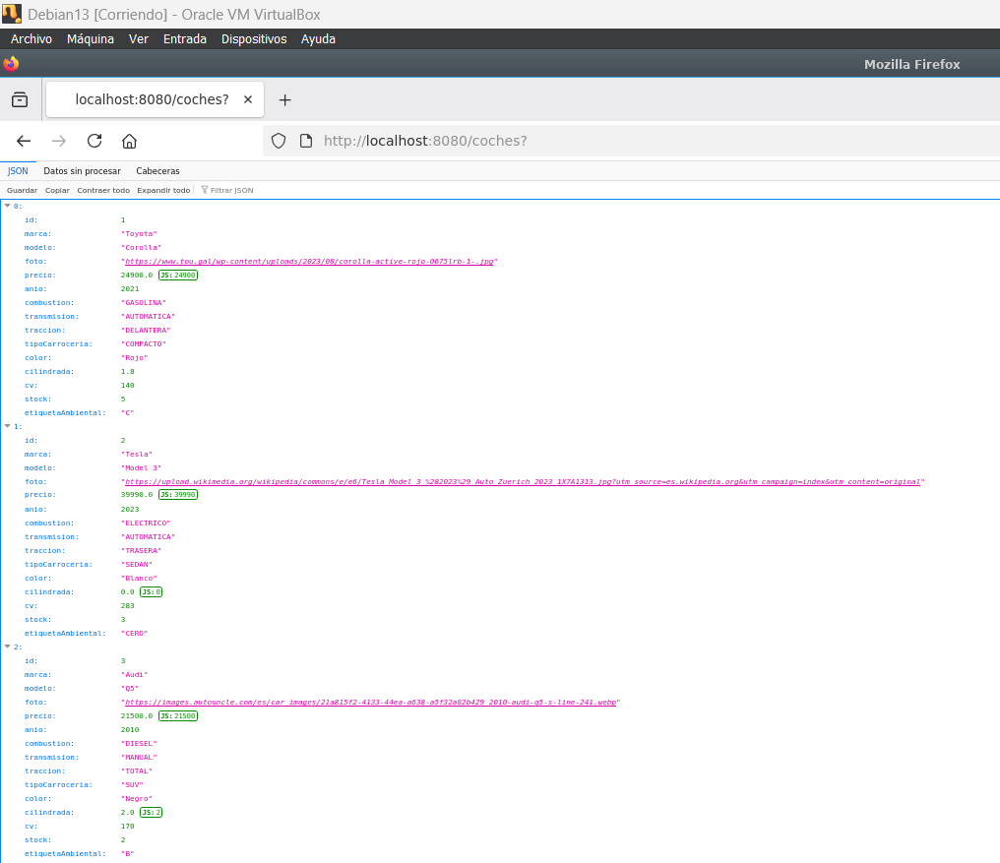 |
| P02 | Ficha con etiqueta C | Ficha del coche creado con etiqueta C | OK | 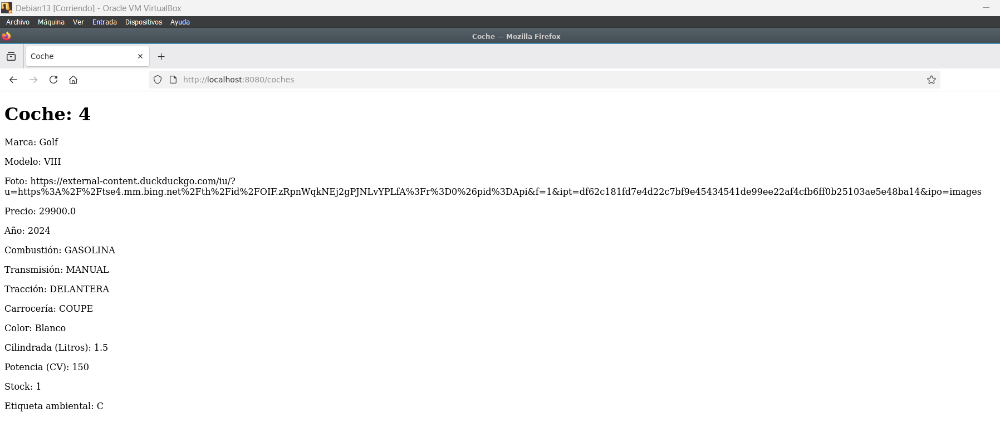 |
| P03 | Error 400 (cilindrada) | Error 400 con el mensaje "Si no es eléctrico, la cilindrada debe ser mayor que 0" | OK | 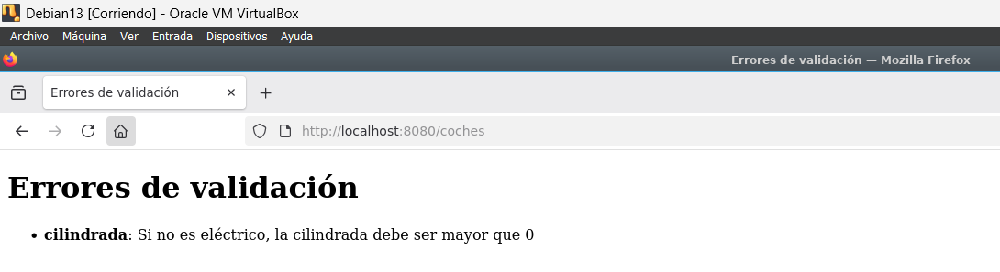 |
| P04 | Error 400 (potencia excesiva) | Error 400 con el mensaje "La potencia es demasiado alta para esa cilindrada (máximo 250 CV por litro)" | OK | 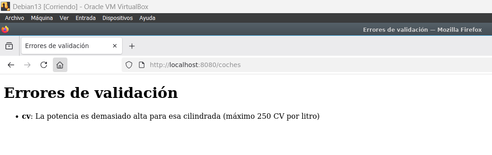 |
| P05 | Etiqueta ECO | Ficha del coche creado con etiqueta ambiental ECO | OK | 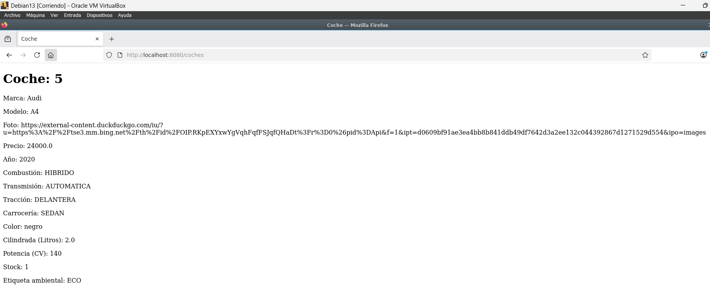 |
| P06 | Coche actualizado | Coche 1 con precio 28000, año 2023, 2.0 L, 150 CV y stock 3 | OK | 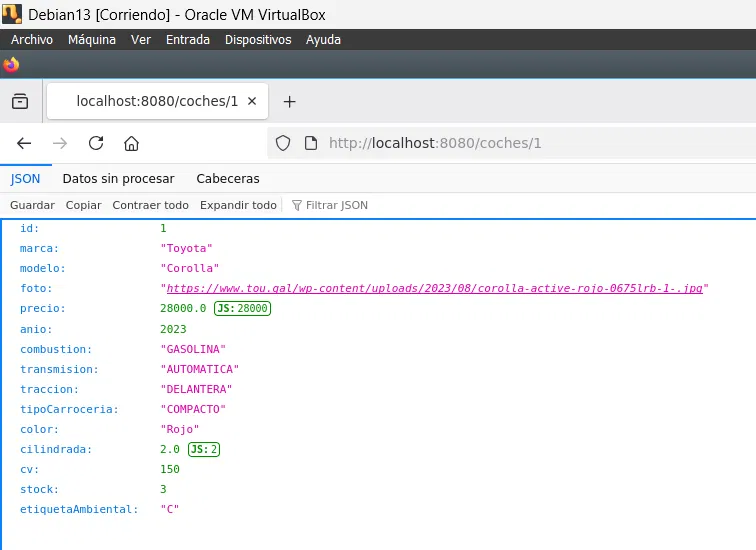 |
| P07 | Error 404 | Error 404 con el mensaje "Coche con id 99 no se encuentra" | OK | 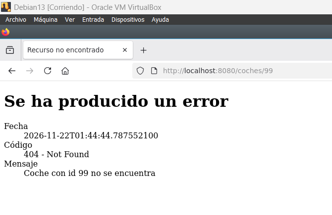 |
| P08 | 204 y coche eliminado | El formulario no muestra contenido (204) y en el listado el coche 2 ya no aparece | OK | 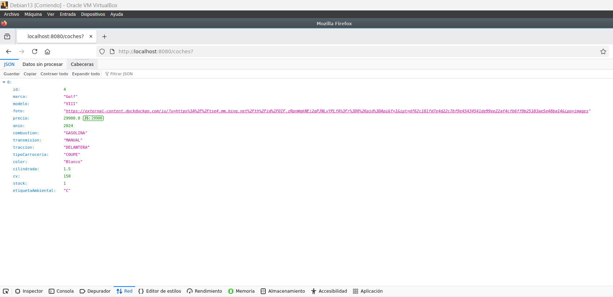 |

---

## Funcionamiento de la aplicación

---

### Listar coches (GET)

Formulario para consultar el catálogo y resultado con los tres coches:

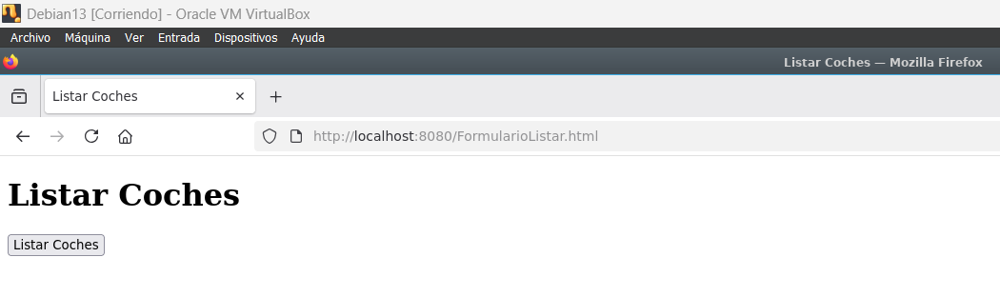

---

### Crear coche (POST)

Formulario de creación.

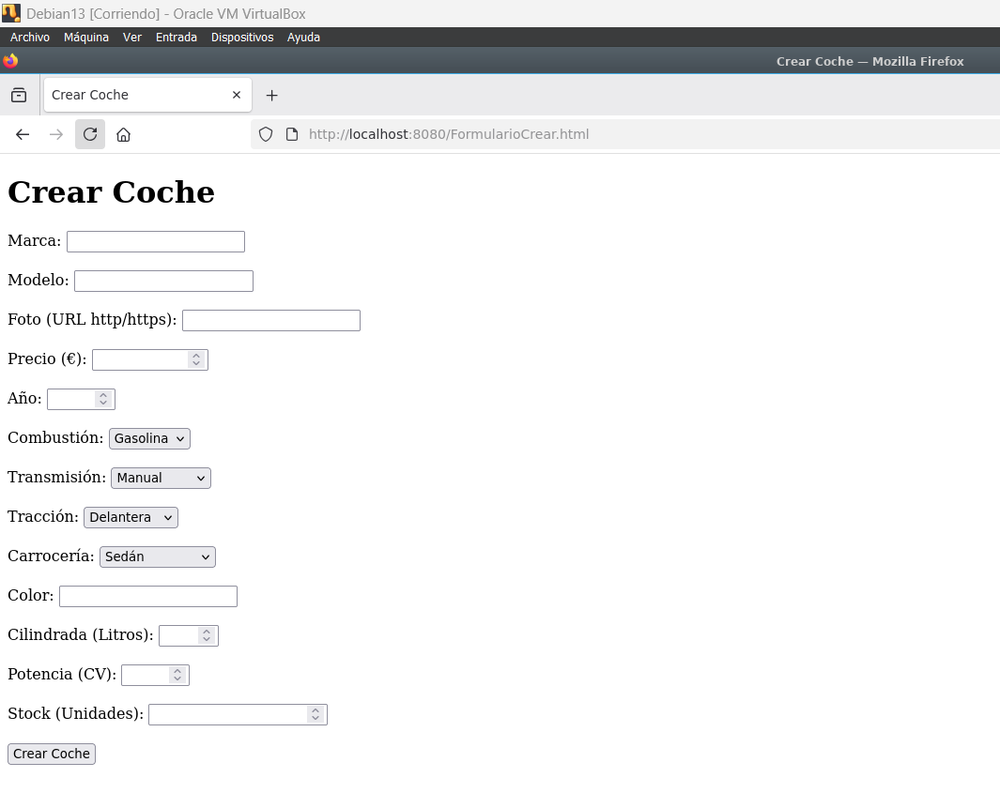

---

### Modificar coche (PUT)

Formulario de edición con el id del coche y resultado con los datos actualizados:

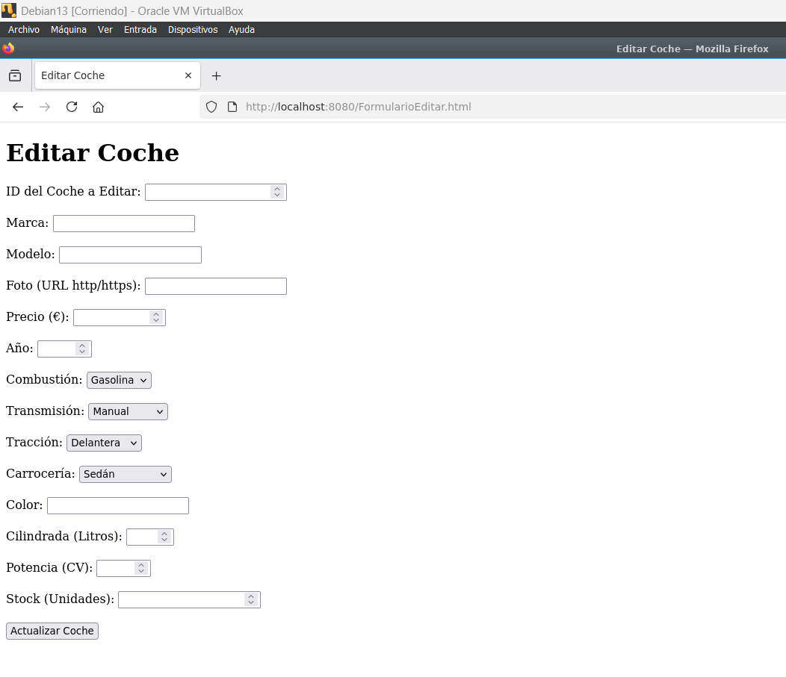

---

### Eliminar coche (DELETE)

Formulario de eliminación con el id del coche y listado posterior, donde ya no aparece:

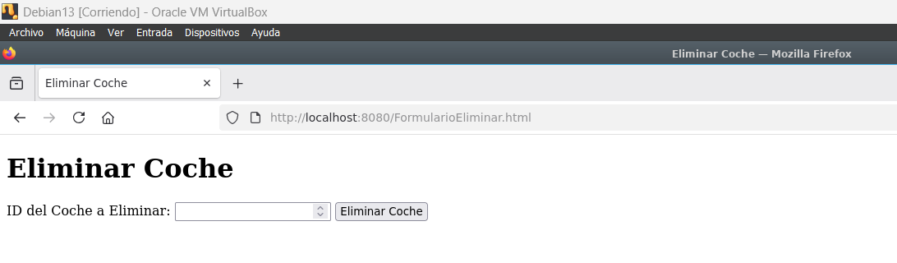

---

[README](../README.md) | [Volver](03-implementacion.md) | [Siguiente: 05-elementos-destacables.md](05-elementos-destacables.md)